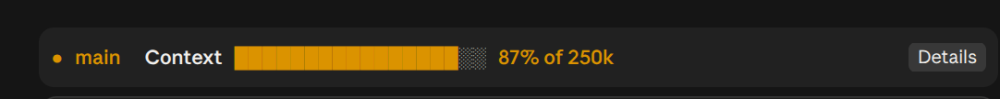
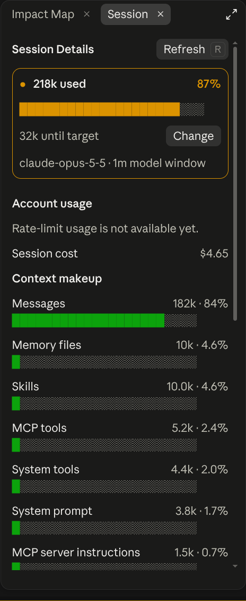

# Session HUD

Session HUD draws a compact telemetry strip above the prompt with the current Git branch, context usage, a visual progress bar, and overall weekly account usage.



## Install

```bash
claude plugin install session-hud@traversy-mods
```

Restart the session or enter `/reload-plugins` after installation.

## How it works

The branch signal and name appear first. Working branches use green. `main` and `master` use yellow as a reminder that you are on the default branch. Detached HEAD states are also yellow, and folders outside a Git repository say so directly. Session HUD checks every five seconds, so it also catches branch changes made in the built-in terminal or another terminal. Branches changed by a Claude Bash tool refresh immediately.

The context meter carries the strongest visual weight, followed by the compact `Week` label for overall seven-day account usage. Select `Details` to open Session Details. Its context-budget summary shows how much context is used, the percentage of the personal target, and how much headroom remains. The pane also shows:



- Five-hour account usage with its reset time
- Weekly account usage with its reset time
- Session cost when Claude Code reports one
- A color-coded meter for your personal context target

Claude Code also counts the current context and shows:

- Clean progress bars for messages, system content, tool schemas, memory, skills, and agents
- Messages as one conversation total
- Loaded MCP tokens grouped by server, with tool details available from a server picker
- Free space and the automatic compaction buffer

The full breakdown runs only when you click `Details` or press Refresh. It does not poll in the background. Claude Code provides a reliable total for Messages, but it does not provide a reliable token count for every individual message.

In the terminal, Session Details uses a narrower compact layout that keeps both account-usage windows visible sooner. The `Details` control hides while that pane is open. The Desktop layout keeps its roomier spacing.

The context percentage uses a configurable personal target. It does not change Claude's actual context window or automatic compaction behavior.

## Change the context target

Open Session Details and select `Change` beside the current target. Enter a value such as `200k`, `300k`, `750k`, or `1m`, then press Enter to save it. You can also open Claude Code's `/config` menu and change `Context target` there.

The setting is saved with the plugin and applies to future sessions. The default is 300k, and accepted values range from 10k through 10m.

The meter is green below 70 percent, yellow from 70 through 89 percent, and red at 90 percent or higher. Its visual fill stops at 100 percent, but the numeric percentage can go higher.

## Test Session HUD

1. Install and load `session-hud`.
2. Send a prompt so Claude Code records session usage.
3. Look directly above the prompt box.
4. Confirm that the branch signal, context meter, percentage, weekly usage, and `Details` control appear.
5. Switch branches in the built-in terminal and confirm that the label updates within five seconds.
6. Confirm that the `Week` label shows your weekly percentage.
7. Select `Details` beside the progress bar.
8. Confirm that Session Details shows context headroom, five-hour usage, weekly usage, session cost, context categories, and any connected MCP tool schemas.
9. Select `Change`, enter another context target, and confirm that the percentage updates after the mod reloads.

## Source

[`hooks/register.tsx`](./hooks/register.tsx)

[Back to the mod index](../README.md#included-mods)
