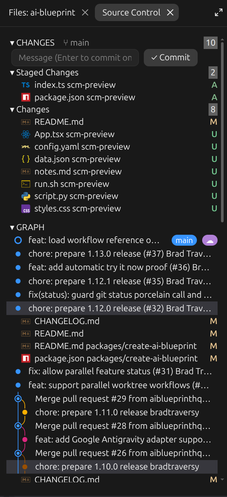

# Source Control

Source Control opens a pane beside the chat modeled on VS Code's Source Control view. It shows the session's Git changes in Merge, Staged and Changes groups, lets you stage, unstage, discard and commit, and draws the commit graph below them. On the desktop each file shows the same icon VS Code shows when the vscode-icons theme is installed.



- Changes grouped as VS Code groups them, with counts and VS Code's status colors
- Stage, unstage and discard per file or per group, with discard asking first
- A commit message box that commits on Enter
- The commit graph, with the current branch and its upstream labeled
- Click a commit to list its files, and click a file to open it in VS Code

## Install

Add the marketplace once, then install the mod:

```bash
claude plugin marketplace add bradtraversy/traversy-claude-mods
claude plugin install source-control@traversy-mods
```

Restart the session or enter `/reload-plugins` after installation. Run `/plugin` to confirm it is enabled.

The pane opens by itself when a session starts inside a Git repository. Enter `/scm` to open it again after closing it.

## Changes

The `CHANGES` header shows the current branch, how far it is ahead of or behind its upstream, and the total number of changed files. Below it, the commit message box and up to three groups:

- `Merge Changes` for files with merge conflicts
- `Staged Changes` for files in the index
- `Changes` for modified, deleted and untracked files

Each row shows the file name, its folder, and the status letter in VS Code's colors: `M` modified, `A` added, `D` deleted, `R` renamed, `U` untracked. Click a group header to collapse it.

Row actions match VS Code. On the desktop they appear when you hover a row or group header; in the terminal they are always visible.

- `+` stages a file, or every file in the group
- `−` unstages a file, or every staged file
- `↶` discards changes. The pane asks first, inline, and says when the discard deletes an untracked file.

Clicking a file opens it in VS Code. A deleted file shows a short message instead.

## Commit

Type a message and press Enter, or select `✓ Commit`. The pane commits what is staged. When nothing is staged, it asks whether to stage everything and commit it in one step, as VS Code does.

The pane never pushes, pulls or fetches. Use the terminal or VS Code for those.

## Graph

On the desktop the graph uses VS Code's swimlane layout, colors and merge curves. In the terminal it is `git log --graph` in color. The current branch has a blue label and its upstream a purple one; when both point at the same commit, the upstream folds to a cloud. Tags and other branches are not labeled, matching VS Code.

Click a commit to list the files it changed against its first parent. Click a file to open it in VS Code as it is in the working tree now. The graph shows 50 commits at first, and `Load More` adds 50 more.

## File icons

On the desktop, Source Control reads the [vscode-icons](https://marketplace.visualstudio.com/items?itemName=vscode-icons-team.vscode-icons) theme from `~/.vscode/extensions`, using the newest installed version, and resolves each file the way VS Code does: exact file name first, then the longest matching extension, then the file's VS Code language, then the theme's default file icon. Each icon is read once per session.

When vscode-icons is not installed, or an icon cannot be read, the row falls back to a small colored letter code such as `TS` or `{}`. The terminal always uses the letter codes.

## Refreshing

The pane reads the repository again after Claude edits or writes a file, after a Bash command that runs `git`, at the end of each turn, and when you select a refresh button. It does not poll, so changes made outside Claude show up at the end of the next turn or when you refresh.

## Things to know

- Commits made from the pane run without your repository's Git hooks. Claude Code runs Git from mods with repo hooks off, so `pre-commit` and `commit-msg` hooks do not run. Commit from the terminal or VS Code when a hook matters.
- Opening files in VS Code works on Linux. The pane runs `code -g <file>` through `systemd-run --user`, so the snap build of VS Code starts even from the desktop app. On other systems, clicking a file shows a message that it could not be opened.
- The pane follows the session's working directory. Start the session inside the repository you want to see.
- Very long change lists show their first 300 files per group.

## Test Source Control

1. Install and load `source-control`, then start a session inside a Git repository.
2. Confirm the pane opens beside the chat with the branch name in the header.
3. Ask Claude to edit a tracked file and confirm the file appears under `Changes` with an `M`.
4. Hover the row and select `+`. Confirm it moves to `Staged Changes`.
5. Type a commit message and press Enter. Confirm the commit appears at the top of the graph.
6. Click that commit and confirm its files are listed beneath it.
7. Create an untracked file, select `↶` on its row, and confirm the pane asks before deleting it.

## Uninstall

```bash
claude plugin uninstall source-control@traversy-mods
```

## Source

- [`hooks/register.tsx`](./hooks/register.tsx): the pane, actions and refresh
- [`hooks/git.ts`](./hooks/git.ts): status and log parsing, and the Git command for each action
- [`hooks/graph.ts`](./hooks/graph.ts): the swimlane graph and branch labels
- [`hooks/icons.ts`](./hooks/icons.ts): vscode-icons lookup
- [`hooks/open.ts`](./hooks/open.ts): opening a file in VS Code

[Back to the mod index](../README.md#included-mods)
